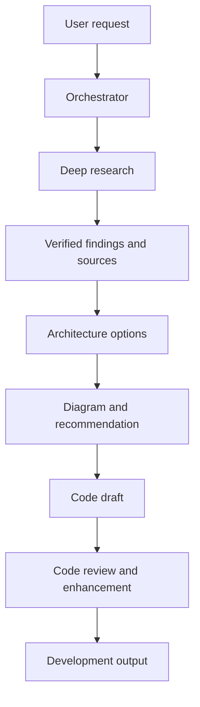

# Deep Agent

Deep Agent is a multi-agent software engineering assistant designed to support
the development cycle from early research through implementation planning and
code improvement. It exposes a versioned FastAPI endpoint and coordinates
specialist agents behind a single orchestrator.

## What it can help with

- **Deep research:** Break a topic into focused search queries, retrieve web
  results, read relevant pages, extract and verify claims, and produce a
  sourced report.
- **Architecture exploration:** Present multiple viable architectures and
  technology stacks, explain trade-offs, include an architecture diagram, and
  recommend an approach based on the stated constraints.
- **Code drafting:** Use the selected approach and research findings to help
  draft implementation code in the context of the project.
- **Code review and enhancement:** Review code, identify improvement
  opportunities, and suggest or produce refinements.

The orchestrator selects the specialist(s) relevant to each request. It can
chain research, architecture, and code-review work when a request spans those
areas; it does not need to run every specialist for every question.

## Development workflow



The agent can also handle a request focused on one stage directly—for example,
researching a topic or reviewing an existing implementation—without forcing
the entire workflow.

## Application architecture

- **API:** FastAPI routes are grouped under `/api/v1`.
- **Dependency injection:** The chat route receives its `AgentSetup` through
  FastAPI's `Depends(get_agent_setup)`. The dependency selects an agent setup
  from application state based on the requested provider, with Gemini as the
  fallback.
- **Startup and lifespan:** The application registers LLM clients and
  initializes reusable HTTP and agent resources during FastAPI startup, then
  closes clients during shutdown.
- **Agents and tools:** A deep researcher graph handles the plan/search/read/
  verify/report workflow. Architecture and code-review agents use the search
  and webpage-reading tools.
- **Conversation state:** The agent uses a LangGraph in-memory checkpointer.
  Provide the same `session_id` to continue a thread while the process remains
  running. This in-memory state is not persistent across application restarts.

## API

### `POST /api/v1/chat`

Example request:

```json
{
  "message": "Research options for a secure file upload service, compare architectures, recommend one, and draft a FastAPI implementation.",
  "provider_name": "gemini",
  "provider": "gemini",
  "session_id": null
}
```

`session_id` is optional. Reuse a returned thread ID as the session ID to
continue a conversation. The response contains the assistant's answer and
execution metadata, including the thread ID and any reported tools or
sub-agents.

Health endpoints:

- `GET /health`
- `GET /actuator/health/readiness`
- `GET /actuator/health/liveness`

Interactive API documentation is available at `/docs` while the server is
running.

## Requirements

- Python `>=3.13,<3.14` (as configured in `pyproject.toml`)
- Poetry
- A Gemini API key

## Run with Poetry

From the project root:

1. Install Python 3.13 and Poetry if they are not already installed.
2. Configure Poetry to use Python 3.13 and install the project dependencies:

   ```powershell
   poetry env use 3.13
   poetry install
   ```

3. Create a `.env` file in the project root and add your Gemini API key:

   ```dotenv
   GEMINI_API_KEY=your-gemini-api-key
   GEMINI_MODEL_NAME=gemini-3.1-flash-lite
   LANGSMITH_TRACING=true
   LANGSMITH_ENDPOINT=https://api.smith.langchain.com
   LANGSMITH_API_KEY=your-langsmith-api-key
   LANGSMITH_AGENT_ID=deep-agent
   LANGSMITH_AGENT_ENVIRONMENT=local
   ```

   The application loads `.env` at startup without overriding environment
   variables supplied by the deployment. Provide credentials through your platform's
   secret manager rather than a checked-in file.

   LangSmith tracing sends agent/model inputs, outputs, and run metadata to
   LangSmith. Create the `deep-agent` agent and its `local` environment in your
   LangSmith workspace before running the app. Set `LANGSMITH_TRACING=false`
   to disable tracing when needed, and avoid sending sensitive data unless your
   organization's data-handling policy allows it.

4. Start the API using either command:

   ```powershell
   poetry run deep-agent
   ```

   or:

   ```powershell
   poetry run uvicorn src.main:app --reload
   ```

5. Open `http://127.0.0.1:8000/docs` to inspect and call the API.

The server binds to `127.0.0.1:8000` by default. The `--reload` option is
intended for local development.

## Configuration

Settings can be provided in `.env` or through environment variables:

| Setting | Purpose | Default |
|---|---|---|
| `GEMINI_API_KEY` | Gemini API credential | Not set |
| `ENABLE_GEMINI` | Enable Gemini client registration | `true` |
| `GEMINI_MODEL_NAME` | Gemini model name | `gemini-3.1-flash-lite` |
| `DDG_HTML_URL` | DuckDuckGo HTML search endpoint | `https://html.duckduckgo.com/html/` |
| `MAX_SUB_QUESTIONS` | Maximum research sub-questions | `5` |
| `SOURCES_PER_QUESTION` | Search sources per research question | `3` |
| `LANGSMITH_TRACING` | Enable LangSmith tracing | `false` unless configured |
| `LANGSMITH_ENDPOINT` | LangSmith API endpoint | `https://api.smith.langchain.com` |
| `LANGSMITH_API_KEY` | LangSmith API credential | Not set |
| `LANGSMITH_AGENT_ID` | Registered LangSmith agent ID | Not set |
| `LANGSMITH_AGENT_ENVIRONMENT` | Registered agent environment | Not set |

Although the request model includes other provider names, Gemini is the LLM
client currently registered by the application.

`gemini-3.1-flash-lite` is selected as the default model. Model availability
and rate limits can still vary; a 503 may be a temporary capacity issue
rather than a problem with the request.